# Phân tích dữ liệu Olist: nội dung từng slide

Nội dung chép nguyên từ bộ slide (18 trang). Hình nằm trong thư mục `outputs/figures/`.

---

## Slide 1. Bìa

- Trường Đại học Phenikaa · Khoa Công nghệ thông tin
- **Phân tích và trực quan hóa dữ liệu thương mại điện tử Olist**
- Bài tập lớn học phần Trực quan hóa dữ liệu
- Sinh viên: **Nguyễn Công Phước** · MSSV 24103624
- Giảng viên hướng dẫn: Nguyễn Văn Tới
- Hà Nội, 2026

**Ghi chú thuyết trình:** Giới thiệu đề tài: phân tích bộ dữ liệu công khai của Olist, sàn thương mại điện tử Brazil, giai đoạn 2016-2018.

---

## Slide 2. Dữ liệu và quy trình

**Bộ dữ liệu Olist: 9 bảng, gần 100 nghìn đơn**

- **99.441**: đơn hàng gốc, từ 09/2016 đến 10/2018
- **96.470**: đơn đã giao, dùng để phân tích
- **93.350**: khách hàng khác nhau
- **3.095**: người bán trên nền tảng

Quy trình:

1. **Làm sạch**: Giá trị thiếu, dòng trùng, tọa độ sai
2. **Gộp bảng**: Mỗi đơn một dòng, thêm thời gian giao, khoảng cách
3. **Trực quan hóa**: 13 biểu đồ, mỗi biểu đồ trả lời một câu hỏi
4. **Học máy**: Phân khúc K-Means, dự đoán đánh giá thấp

**Ghi chú thuyết trình:** Bộ dữ liệu công khai trên Kaggle, gồm 9 bảng CSV nối với nhau qua order_id, customer_id, product_id và seller_id. Chỉ giữ đơn có trạng thái delivered và có ngày giao thực tế, còn 96.470 đơn. Công cụ: pandas, Matplotlib, scikit-learn.

---

## Slide 3. Xu hướng theo thời gian

**Số đơn tăng mạnh năm 2017, đi ngang năm 2018**

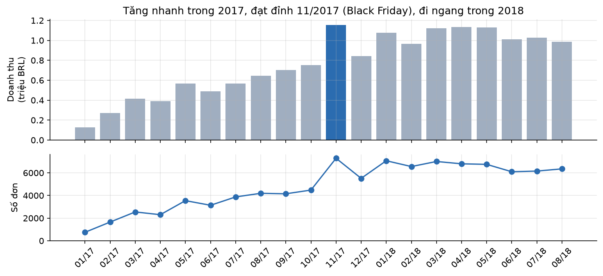

- **+140%**: số đơn 8 tháng đầu 2018 so với cùng kỳ 2017
- **7.288 đơn**: đỉnh tháng 11/2017, nhờ Black Friday
- **6.100–7.100**: đơn mỗi tháng năm 2018, gần như đi ngang

**Ghi chú thuyết trình:** Hình chỉ lấy 01/2017 đến 08/2018 vì năm 2016 và hai tháng cuối 2018 có rất ít dữ liệu. Ngày Black Friday 24/11/2017 có 1.147 đơn, gấp khoảng 6,3 lần trung vị số đơn mỗi ngày của tháng 11. Tháng 12/2017 có Giáng sinh nhưng số đơn lại giảm.

---

## Slide 4. Thói quen mua hàng

**Khách mua nhiều vào đầu tuần và ban ngày**

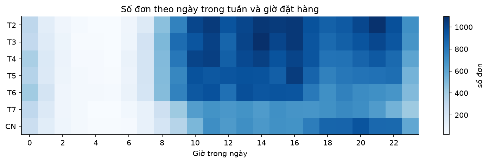

- **16,3%**: số đơn rơi vào thứ Hai, ngày đông nhất
- **23%**: số đơn rơi vào hai ngày cuối tuần
- **75,6%**: số đơn đặt trong khung 10 giờ đến 21 giờ

**Ghi chú thuyết trình:** Màu càng đậm càng nhiều đơn. Gần như không có đơn từ 2 đến 6 giờ sáng. Kết quả ngược với nhận định thường gặp là mua sắm trực tuyến dồn vào cuối tuần. Gợi ý: gửi email, thông báo vào sáng đầu tuần, bảo trì hệ thống lúc rạng sáng.

---

## Slide 5. Danh mục sản phẩm

**10 trong 71 danh mục tạo 62,4% doanh thu**

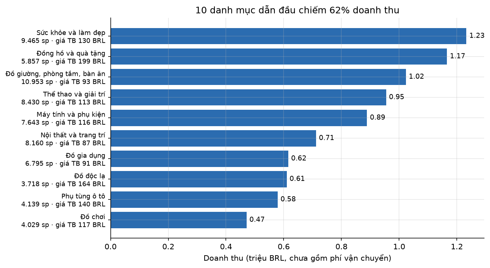

- **1,23 triệu BRL**: Sức khỏe và làm đẹp, danh mục dẫn đầu
- **10.953**: sản phẩm đồ giường, phòng tắm, giá TB chỉ 93 BRL
- **~200 BRL**: giá TB đồng hồ, quà tặng: bán ít hơn nhưng giá cao

**Ghi chú thuyết trình:** Có hai kiểu danh mục: bán được nhiều (đồ giường, nội thất, đồ gia dụng) và bán được giá cao (đồng hồ, quà tặng). Nhóm bán nhiều cần giảm phí vận chuyển, khuyến khích mua kèm; nhóm giá cao cần chú trọng độ tin cậy và hình ảnh sản phẩm. Giá trung vị một sản phẩm chỉ 74,9 BRL.

---

## Slide 6. Thanh toán

**Thẻ tín dụng áp đảo, khách trả góp nhiều**

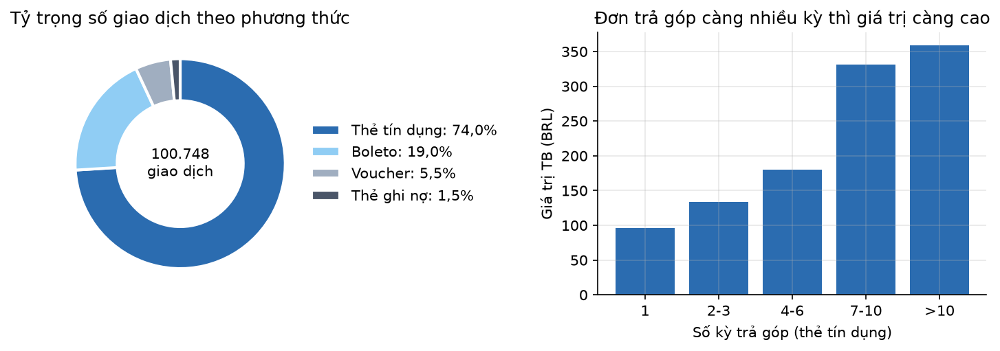

- **74,0%**: giao dịch bằng thẻ tín dụng (78,5% giá trị)
- **66,8%**: giao dịch thẻ chia từ 2 kỳ trở lên
- **96 → 331 BRL**: giá trị TB: trả 1 lần so với trả 7–10 kỳ

**Ghi chú thuyết trình:** Boleto đứng thứ hai với 19,0% số giao dịch: phiếu thanh toán có mã vạch, trả tại ngân hàng hoặc cửa hàng, phù hợp với người không có thẻ tín dụng. Trả góp không lãi (parcelado sem juros) rất phổ biến ở Brazil, là công cụ tốt để bán sản phẩm giá cao.

---

## Slide 7. Phân bố địa lý

**Đơn tập trung ở Đông Nam, giao lâu ở phía Bắc**

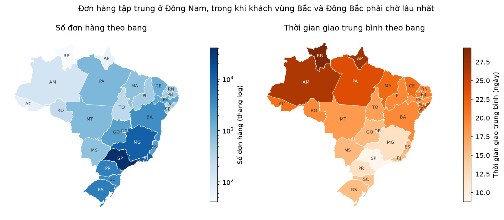

- **42%**: số đơn đến từ bang São Paulo (SP)
- **8,8 → 29,4 ngày**: thời gian giao TB: São Paulo so với Roraima
- **59,7%**: người bán ở SP, đơn vùng xa phải đi liên bang

**Ghi chú thuyết trình:** Bản đồ trái dùng thang logarit để các bang ít đơn vẫn phân biệt được. Hai bản đồ ngược nhau: nơi nhiều đơn thì giao nhanh. Phí vận chuyển trung bình cũng tăng từ 17,3 BRL ở SP lên 40-49 BRL ở nhiều bang phía Bắc và Đông Bắc.

---

## Slide 8. Thời gian giao theo vùng

**Vùng càng xa, giao càng lâu và khó đoán**

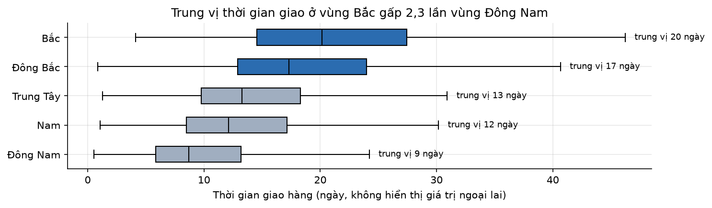

- **8,7 ngày**: trung vị thời gian giao ở vùng Đông Nam
- **20,2 ngày**: trung vị ở vùng Bắc, gấp hơn 2 lần
- **434 km**: khoảng cách trung vị từ người bán đến khách

**Ghi chú thuyết trình:** Hộp là khoảng tứ phân vị 25-75%, vạch đen là trung vị. Vùng xa không chỉ giao lâu hơn mà còn phân tán hơn: 10% đơn chậm nhất ở vùng Bắc mất hơn 36,6 ngày, ở Đông Nam là 19,6 ngày. Chỉ 36% đơn có người bán và khách cùng bang.

---

## Slide 9. Người bán

**Doanh thu dồn vào một nhóm nhỏ người bán**

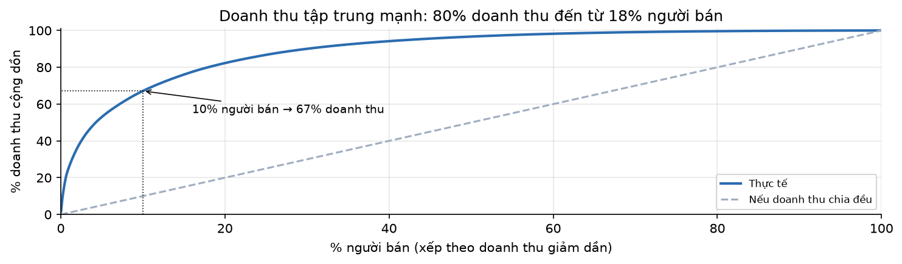

- **17,9%**: người bán tạo ra 80% doanh thu
- **67,1%**: doanh thu đến từ 10% người bán lớn nhất
- **80/20**: rất gần nguyên tắc Pareto: cần giữ người bán lớn

**Ghi chú thuyết trình:** Đường cong càng cách xa đường chéo thì doanh thu càng tập trung. Trong 3.095 người bán, nếu nhóm lớn rời nền tảng thì doanh thu giảm mạnh, nên giữ người bán lớn cần được quan tâm không kém thu hút người bán mới.

---

## Slide 10. Thời gian giao hàng

**Đa số đơn đến sớm hơn ngày dự kiến**

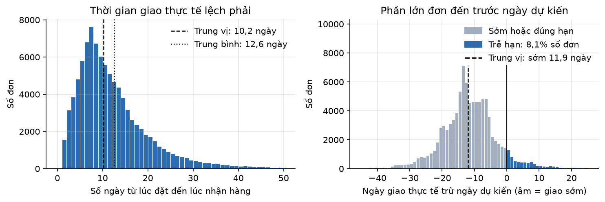

- **10,2 ngày**: trung vị thời gian giao (trung bình 12,6 ngày)
- **11,9 ngày**: một đơn điển hình đến sớm hơn ngày hẹn
- **8,1%**: số đơn giao trễ so với ngày dự kiến

**Ghi chú thuyết trình:** Phân phối lệch phải: 1% đơn chậm nhất mất hơn 46 ngày, kéo trung bình lên cao hơn trung vị, nên trung vị phản ánh đơn điển hình sát hơn. Ngày dự kiến trung bình là 23,7 ngày, rất dư. Thời hạn dài giữ tỷ lệ trễ thấp nhưng có thể khiến khách bỏ giỏ hàng.

---

## Slide 11. Giao trễ theo thời gian

**Tỷ lệ trễ tăng vọt vào mùa cao điểm**

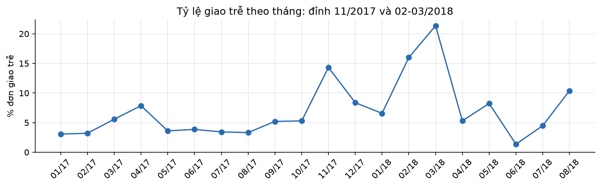

- **3–8%**: tỷ lệ trễ mỗi tháng từ 01 đến 10/2017
- **14,3%**: đơn đặt tháng 11/2017, dịp Black Friday
- **21,4%**: tháng 3/2018, cao nhất, chưa rõ nguyên nhân

**Ghi chú thuyết trình:** Tháng 11/2017 lượng đơn tăng đột ngột, logistics không theo kịp. Tháng 2 và 3/2018 (16,0% và 21,4%) số đơn không nhiều hơn các tháng xung quanh; nguyên nhân có thể là thời tiết, kỳ nghỉ Carnaval hoặc năng lực đối tác vận chuyển, nhưng mới là giả thuyết.

---

## Slide 12. Phát hiện chính

**Giao trễ gắn chặt với đánh giá 1–2 sao**

- **54,1%**: đơn giao trễ bị chấm 1–2 sao
- **9,2%**: đơn đúng hoặc sớm hơn hẹn bị chấm 1–2 sao

**Ghi chú thuyết trình:** Đây là kết quả quan trọng nhất của phần phân tích khám phá: tỷ lệ đánh giá thấp ở đơn trễ gấp khoảng 6 lần đơn đúng hẹn. Đây là mối liên hệ, chưa chứng minh quan hệ nhân quả.

---

## Slide 13. Đánh giá của khách

**Trễ quá 3 ngày, đánh giá thấp tăng vọt**

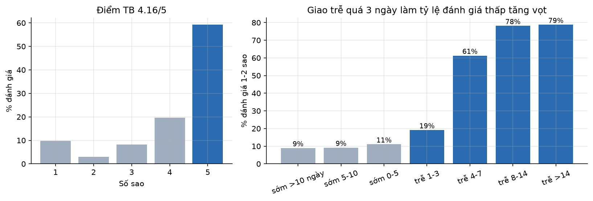

- **4,16 / 5**: điểm trung bình; 59,2% đánh giá là 5 sao
- **19% → 61%**: tỷ lệ 1–2 sao: trễ 1–3 ngày so với trễ 4–7 ngày
- **4 / 5 khách**: chấm 1–2 sao khi đơn trễ hơn một tuần

**Ghi chú thuyết trình:** Tác động bất đối xứng: giao sớm 2 ngày hay 2 tuần đều có khoảng 9-11% đánh giá thấp, còn giao trễ làm điểm giảm mạnh, phù hợp với lý thuyết triển vọng của Kahneman và Tversky. Ngưỡng khoảng 3 ngày: đơn sắp trễ quá 3 ngày nên được liên hệ trước.

---

## Slide 14. Học máy · Phân khúc RFM

**Chọn k = 4 cụm cho K-Means**

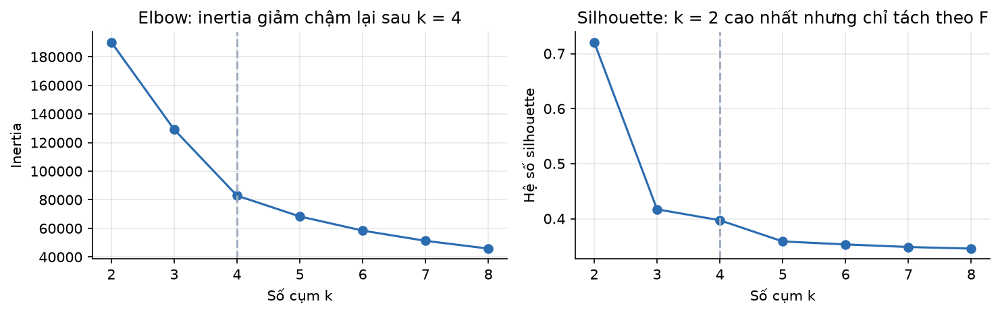

- **k = 2**: silhouette 0,72 nhưng chỉ tách theo số đơn
- **190k → 83k**: inertia giảm mạnh từ k = 2 đến k = 4
- **k = 4**: silhouette 0,397, tách thêm nhóm có ý nghĩa

**Ghi chú thuyết trình:** RFM: Recency là số ngày từ lần mua cuối, Frequency là số đơn, Monetary là tổng tiền đã chi. Ba biến lệch phải nên được biến đổi log(1 + x) và chuẩn hóa trước khi phân cụm. Với k = 2, hai cụm chỉ là khách mua một lần và khách mua nhiều lần, không cho thêm thông tin.

---

## Slide 15. Học máy · Phân khúc RFM

**34% khách chi tiêu cao tạo 62% doanh thu**

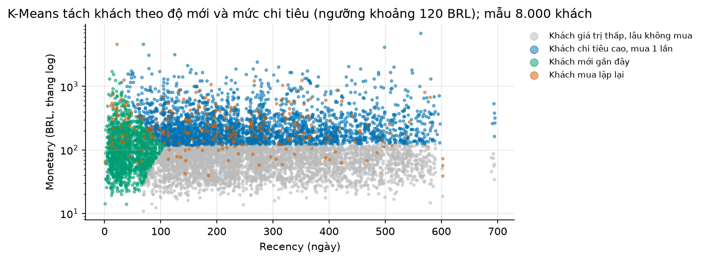

- **34,4%**: Chi tiêu cao, mua một lần
- **45,3%**: Giá trị thấp, lâu không mua
- **17,3%**: Khách mới gần đây
- **3,0%**: Khách mua lặp lại

**Ghi chú thuyết trình:** Phần trăm là tỷ lệ số khách trong mỗi nhóm. Nhóm chi tiêu cao chi trung bình 296 BRL và đã khoảng 9 tháng chưa quay lại, đây là nhóm có giá trị nhất. 97% khách chỉ mua một lần, nên tăng trưởng của Olist gần như chỉ dựa vào khách mới. Khách mua lặp lại tuy ít nhưng chi tiêu bình quân cao nhất (308,5 BRL).

---

## Slide 16. Học máy · Dự đoán đánh giá thấp

**Mô hình khoanh vùng được đơn rủi ro cao**

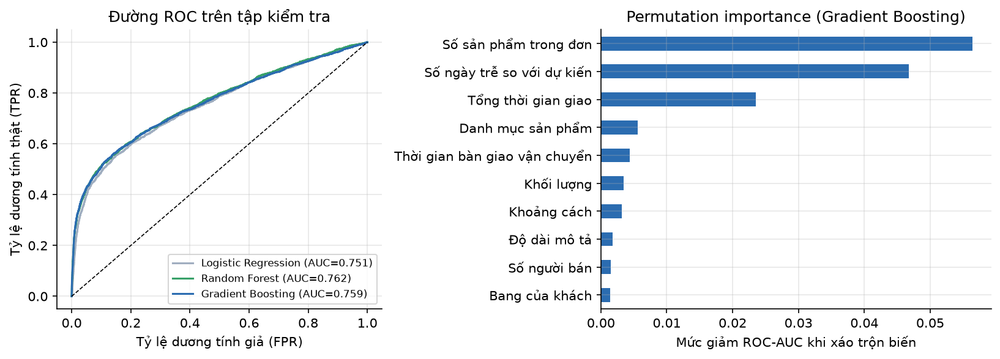

- **0,76**: ROC-AUC Gradient Boosting; quy tắc giao trễ: 0,65
- **55,1%**: đơn trong top 10% rủi ro bị chấm thấp, gấp 4,3 lần
- **Số sản phẩm**: trong đơn là biến quan trọng nhất

**Ghi chú thuyết trình:** Bài toán: dự đoán đơn bị chấm 1-2 sao ngay khi vừa giao xong. Ba mô hình: Logistic Regression (ROC-AUC 0,751), Random Forest (0,762) và Gradient Boosting (0,759). Gradient Boosting được chọn vì PR-AUC cao nhất (0,485), phù hợp với dữ liệu mất cân bằng. Bình luận bị loại khỏi đầu vào để tránh rò rỉ dữ liệu.

---

## Slide 17. Kết luận và đề xuất

**Cần cải thiện giao hàng và giữ chân khách**

Olist tăng nhanh năm 2017 rồi chững lại năm 2018. Chỉ 3% khách quay lại, và điểm đánh giá phụ thuộc nhiều vào việc giao đúng hẹn.

1. **Không để đơn trễ quá 3 ngày**: Theo dõi đơn sắp đến hạn, nhắc người bán bàn giao kịp thời
2. **Chuẩn bị trước mùa cao điểm**: Tăng năng lực giao trước Black Friday, nới hạn giao vài ngày
3. **Ngày giao dự kiến sát thực tế**: Hạn giao đang dư khoảng 12 ngày; thử nghiệm A/B trước khi rút ngắn
4. **Giữ chân khách hàng**: Ưu đãi đơn thứ hai cho khách mới; liên hệ trước 10% đơn rủi ro cao nhất

**Ghi chú thuyết trình:** Hạn chế: dữ liệu chỉ đến 2018, không có chi phí và lợi nhuận; mô hình mới cho thấy mối liên hệ, chưa chứng minh nhân quả; bình luận tiếng Bồ Đào Nha chưa được phân tích. Hướng phát triển: xử lý ngôn ngữ tự nhiên cho bình luận, kiểm định mô hình theo thời gian, dự báo thời gian giao.

---

## Slide 18. Cảm ơn

**Cảm ơn thầy và các bạn đã lắng nghe**

Hỏi và đáp

Dữ liệu: Brazilian E-Commerce Public Dataset by Olist (Kaggle) · Mã nguồn: olist_analysis.ipynb

**Ghi chú thuyết trình:** Kết thúc phần trình bày, mời đặt câu hỏi.
